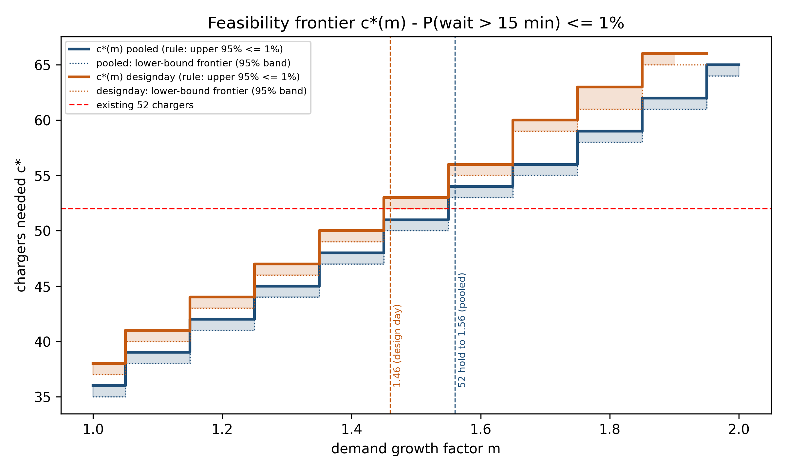
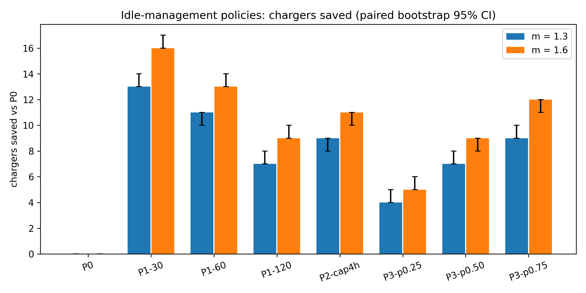

# Smart Sizing of Workplace EV Charging Stations Using Real Data and Simulation

**How many chargers does a workplace garage really need?** We answer this for the Caltech parking garage using
2,953 real charging sessions (Caltech ACN-Data, March-May 2019) and a discrete-event simulation. Drivers arrive over
the day, plug in, and often stay long after the battery is full, so a charger can be "occupied" without charging.
The simulation asks: what is the smallest number of chargers that keeps the share of drivers who wait more than
15 minutes at or below 1 %, as demand grows? The answer: the garage's 52 chargers are more than enough today; about
45 would suffice even with 30 % more demand, and the biggest lever is not more hardware but asking drivers to move
their car once charging has finished.

## Key results

| Result | Value |
|---|---|
| Chargers needed at +30 % demand (c*) | **45** (47 on the busiest weekdays) |
| Growth the existing 52 chargers can absorb | up to about **+56 %** (about +46 % on the busiest days) |
| Plug-in time spent idle (car full, still plugged in) | **56.7 %** of plug-in hours |
| A 60-minute "move after charging" rule | saves **7-11 chargers** (7 at 50 % compliance, 11 at full compliance) |
| Quick queueing formulas | the modified-offered-load rule over-sizes by 5-8 chargers; Erlang-C matches the simulation at 10 of 11 growth levels |

Recommendation: do not buy chargers now; pilot an idle-time rule and measure compliance; buy in stages when observed
growth reaches about +40 %.





## Method in five steps

1. **Data:** 2,953 sessions (2,577 on 65 weekdays), Pacific local time, cleaned and split into arrival time,
   charging time and stay.
2. **Input models:** non-homogeneous Poisson arrivals with 48 half-hour rates; stays drawn from the empirical
   distribution by arrival band; validated against the observed daily occupancy profile.
3. **Simulation:** a Python discrete-event engine (multi-server queue, first come first served), verified against
   FlexSim and against an exact M/M/3 model, with common random numbers across scenarios.
4. **Experiments:** chargers c x demand growth m (1.0-2.0), idle-time policies, peak days, outages and input-model
   sensitivity; the smallest c whose upper 95 % confidence bound of P(wait > 15 min) is at most 1 %.
5. **Decision analysis:** six options (keep 52, buy 2/6/13, voluntary or fee-enforced idle-time rule) compared by
   expected cost, minimax, regret, Hurwicz, value of information and AHP.

## Folder guide

| Folder | Contents |
|---|---|
| `01_Report/` | Course report (PDF, Word) and its evidence map, sources and AI-use statement |
| `02_Papers/` | Short paper, full journal-length paper, highlights, graphical abstract, figures, literature matrix and verified references |
| `03_Presentation/` | Slides (PowerPoint, PDF) |
| `04_FlexSim_Models/` | Main model (c = 45, with dashboard), c = 42 comparison model, M/M/3 verification model (.fsm and .fsx), FlexScript, outputs and screenshots |
| `05_Excel/` | Workbook with the analytic checks, a one-replication replica of the simulation and the decision analysis |
| `06_Code/` | Simulation engine (`engine/ev_des_engine.py`), analysis and document-building scripts, `smoke_test.py` |
| `07_Results/` | Result tables (CSV/JSON) and figures |
| `08_Data/` | Raw ACN extract, derived inputs and `DATA_README.md` |

## How to reproduce

Python 3.12.

```
pip install -r requirements.txt
python 06_Code/smoke_test.py
```

The smoke test re-runs 5 replications at c = 45 and +30 % demand and checks them against the stored results.
The FlexSim models open in FlexSim 2027 (Autodesk). The document-building scripts drive Microsoft Word and Excel and
run on Windows only.

## Authors

- Ahmed Khalid (corresponding author)
- Hossam Bakhashwain
- Ali Al-Qarm

Supervisor: Dr. Omar Sharif Sorata
Department of Industrial Engineering, Faculty of Engineering, Islamic University of Madinah

## Data attribution

Charging-session data: Caltech ACN-Data (https://ev.caltech.edu/dataset). Please cite:
Lee, Z. J., Li, T., & Low, S. H. (2019). ACN-Data: Analysis and applications of an open EV charging dataset.
*e-Energy '19*, 139-149. https://doi.org/10.1145/3307772.3328313

## Licence

Code: MIT (see `LICENSE`). The data in `08_Data/` belong to Caltech ACN-Data and keep its terms of use.
To cite this work, see `CITATION.cff`.
